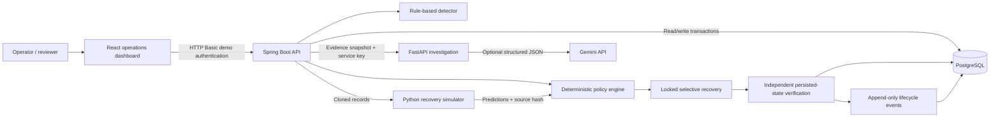

# Architecture

AFI Resolve is Team AFI's independent synthetic prototype for OCBC Ignite 2026, Problem Statement 2: **Intelligent Operations: From Automation to Autonomous Resolution**. It is not an official OCBC product and does not connect to bank systems.

## Responsibilities

| Component | Responsibility | Boundary |
| --- | --- | --- |
| React / TypeScript | Navigation, live metrics, evidence, comparison, workflow controls | No browser-side authorization decisions are trusted |
| Spring Web / Security | Validated API, authenticated actor identity, operator/reviewer enforcement | Public requests cannot execute arbitrary actions |
| Spring workflow services | Detection, evidence, case state, approvals, recovery, verification, audit | Only service allowed to mutate operational tables |
| FastAPI / Pydantic | Evidence-based investigation, optional Gemini, deterministic fallback | No database access, SQL, arbitrary tools or recovery execution |
| Python twin | Pure deterministic simulation over copied records | No write path to PostgreSQL |
| PostgreSQL / Flyway | Durable records, constraints, concurrency, migrations | Numeric amounts, unique processing and execution identifiers |

## Persistence and trust

`transaction_batches` owns batches and a versioned concurrency boundary. `transactions` stores synthetic amount, account, state, unique processing key and processing count. `reconciliation_records` stores associated internal references and decimal amounts. Deliberately inconsistent reconciliation fixtures demonstrate deterministic detection and escalation.

`exceptions` identifies the underlying issue so repeated detection reuses a case. `investigations` records its real method, structured evidence, candidate actions and uncertainty. `simulations` records source hash and predicted effects. `resolution_actions` tracks execution, its unique idempotency key and independently queried verification results. `approvals` records reviewer identity and a justified manual handoff. `audit_logs` retains events even when demo operational data is reset.

AI output is untrusted text. It is schema-validated, restricted to an action enum and never treated as proof that records are safe. Snapshot state and database checks decide eligibility. Missing credentials and provider failures use a clearly labelled deterministic investigation. If the simulator is unavailable, execution does not proceed.

## Recovery safety

1. Collect current transaction and reconciliation evidence.
2. Hash the source state and send an isolated representation to Python.
3. Simulate full retry and pending-only recovery; preserve the original object.
4. Reject attempts to process completed records and inconsistent starting states.
5. Lock the batch, inspect the current database state and compare the source hash.
6. Check case type, investigation certainty, action allowlist, simulation decision and metrics independently.
7. Insert the unique execution key; process only pending synthetic records in a transaction.
8. Query actual persisted transaction and reconciliation state independently.
9. Mark RESOLVED only when verification passes; otherwise preserve an unresolved failure status and audit evidence.

HTTP success alone does not determine resolution. The dashboard shows the stored verification checks and resulting case state.

## Deliberate prototype limits

The twin tests two explicit batch recovery behaviors, not a complete banking system. The full-retry strategy represents an **unguarded** retry; a different idempotent strategy would need its own behavior and tests. Duplicate and ambiguous reconciliation cases are detected and investigated but require a human handoff. Reviewer approval does not invent missing evidence or perform financial corrections.

Demo Basic authentication runs only on localhost through Compose. A production adoption would need organizational identity, TLS, stronger separation of duties, retention controls, operational monitoring and bank-reviewed policies. No real payments, balances, transfers or ledger postings exist here.

Official integration references: [Spring Boot 3.5 system requirements](https://docs.spring.io/spring-boot/3.5/system-requirements.html), [Google Gen AI SDK](https://googleapis.github.io/python-genai/), and [Gemini structured outputs](https://ai.google.dev/gemini-api/docs/structured-output).
